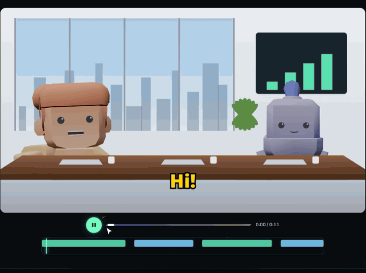
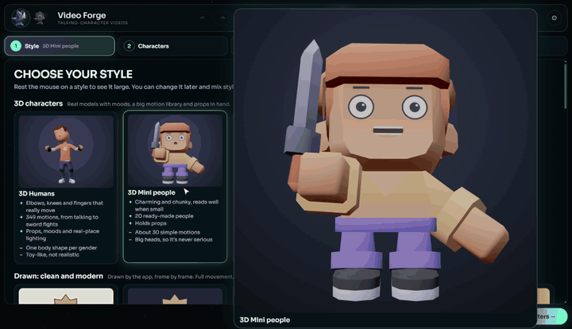
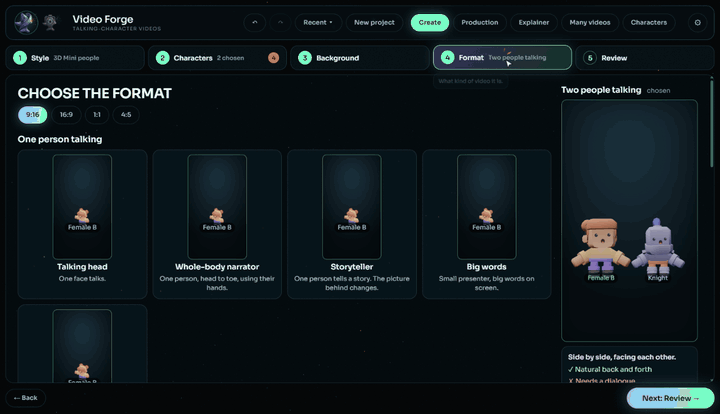
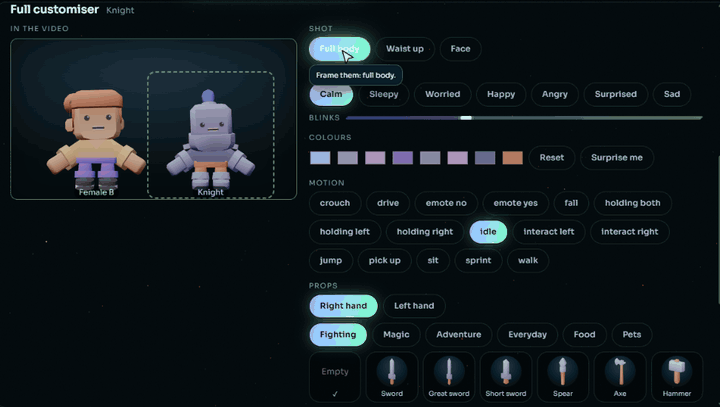
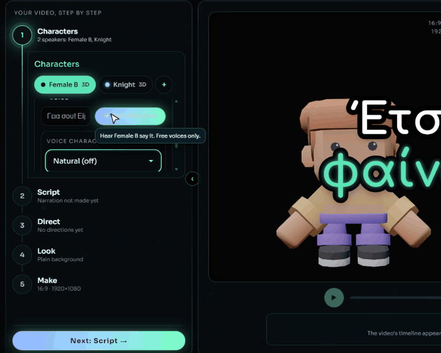
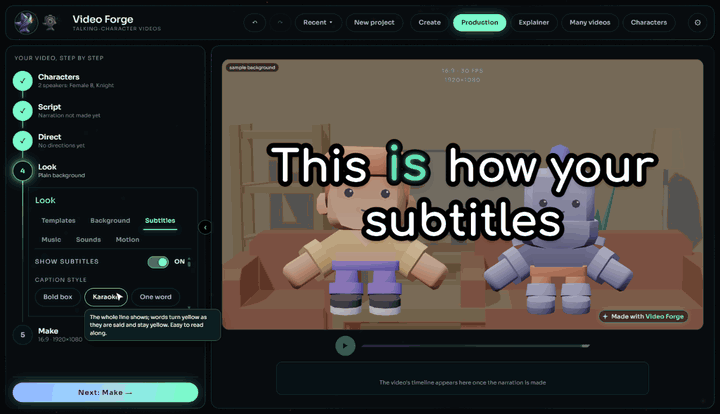

# 🎬 Video Forge

### Type a script. Get a finished video with talking characters, voices and subtitles.

A Windows app that turns your words into a cartoon video: characters that talk, move and lip-sync,
voices in Greek and English, subtitles that light up word by word. On your own PC, with your own keys.

 

&nbsp;

New to all this? Open the guide and pick <b>ELI5</b> at the top: it explains everything like you're five.

  

**Two characters talk. Their mouths follow every word, and the subtitles light up as they speak.**

---

## What it does, in six clips

| | |
|---|---|
|  **Pick your cast.** Ready-made 3D people, pets and drawn characters. Click one, it joins your video. |  **Pick a format.** One person talking, a storyteller, an interview, big faces. Tall, wide, square or feed. |
|  **Make them yours.** Colours, moods, moves and props, with a live preview in the scene. |  **Give each one a voice.** Then a voice character: chibi, warm narrator, deep and dramatic, radio. |
|  **Subtitles your way.** Bold box, karaoke, one word at a time. Greek and English. |  **Press play.** The preview is the video: what you see is what renders. |

## Before → After

**Without Video Forge:** you record your voice, find or draw characters, animate mouths frame by frame,
type subtitles by hand, and stitch it all together in an editor. Days for a few minutes.

**With Video Forge:** you write the script, pick the characters and the look, and press Make.
The voices, lip-sync, subtitles, music and studio sound are done for you.

## 🔒 Your data, in plain words

- **Your keys stay on your PC.** They are saved encrypted by Windows, for your user only ([electron/keyStore.ts](electron/keyStore.ts)).
- **No tracking.** No analytics, no ads, no account. The app's pages can't send data to the internet on their own ([content-security policy](electron.vite.config.ts)).
- **Your videos are made on your PC.** Only the AI helpers you choose (voices, pictures) get the text they need, with your own keys.
- **Free to use**, also for paid work, with one condition: credit "Made with Video Forge" ([licence](#-licence)).

---

## ✨ Everything it can do

- 🧭 **One decision at a time.** The Create flow walks you through style, characters, background and format, each shown with your own characters.
- 🎭 **Characters that act.** Drawn characters, picture puppets, Kenney 3D people, pets and props. They walk, wave, sit, point, and move smoothly from one pose to the next.
- 🎙️ **Voices, free or paid.** Gemini and Fish Audio, Piper offline, ElevenLabs when you want it (it shows the cost and asks first).
- 🎚️ **Studio sound.** Cleaner voices at the loudness YouTube expects, voice characters, voices placed left and right, an optional colour grade.
- 💬 **Subtitles that follow the voice.** The spoken word lights up in the speaker's colour. `.srt` and `.vtt` files come with every video.
- 📐 **Every shape.** Tall 9:16, wide 16:9, square 1:1, feed 4:5, from one script.
- 📚 **Many videos at once.** One sheet row per video, made in a row. Good for whole courses.
- 🖼️ **Works with Image Forge**, its twin app for pictures and puppets.

All of it, step by step: **[the guide](https://docs.stravelakis.com/video-forge/)** (Dev, English or ELI5).

## 🚀 Get it

1. **[Download the latest release](https://github.com/Stravelakis/Video-Forge-BYOK/releases/latest)** (`Video Forge Setup ….exe`, or the portable `.exe`).
2. Double-click it. Windows may say *"Windows protected your PC"*: click **More info**, then **Run anyway**. The app isn't code-signed yet.
3. Add a key (a free Gemini key is enough to start) and press **Create**.

Full steps, and building from the source: [INSTALL.md](INSTALL.md).

## 📖 Docs

| For | Where |
|---|---|
| Everyone | [docs.stravelakis.com/video-forge](https://docs.stravelakis.com/video-forge/): pick **ELI5**, **English** or **Dev** |
| The full manual | [GUIDE.md](GUIDE.md) |
| Installing | [INSTALL.md](INSTALL.md) |
| Script move tags | [docs/MOVE-TAGS.md](docs/MOVE-TAGS.md) |
| What changed | [CHANGELOG.md](CHANGELOG.md) |
| Picking up the work | [HANDOFF.md](HANDOFF.md) |

## 🤖 Built With AI
This project was designed and engineered in collaboration with AI systems:
- You.com — orchestration & research
- Anthropic Claude — architecture, code generation, lip-sync design
- Hermes Agent — automation
- Google Flow — media workflow support
- Human direction & product vision: Stravelakis.

## 💚 Thank you, Kenney
The 3D characters, pets, props and furniture (Mini Characters, Cube Pets,
Animated Characters, Furniture Kit) are by
**Kenney** — [kenney.nl](https://kenney.nl) — released as CC0. Thank you for giving
so much to everyone who makes things. If these help you too, consider
[supporting Kenney](https://kenney.nl/donate).

A few props are by [Quaternius](https://quaternius.com) (CC0). Thank you. The 3D Humans'
motion library uses Mixamo motions, which may not be shared, so the Humans are in
the owner's personal build only. The Windows installer carries
[FFmpeg](https://ffmpeg.org) 9.0.2 (gyan.dev build, GPL v3) as a separate program
for post-production. Details, licences and source links: [NOTICE](NOTICE).

## 📄 Licence
Video Forge is **source available** under the [Forge Attribution License (FAL) v1.2](LICENSE).

- ✅ Free for personal, school and paid work, including running it as an online service.
- 🏷️ The one condition: every video you publish credits
  **"Made with Video Forge - https://stravelakis.com/forge"**. The small label the app adds is a good start; add the address in the description if the label doesn't show it.
- 🔓 Need different terms? [Ask for a more permissive licence](https://stravelakis.com/forge).
- ⚖️ The [full licence](LICENSE) also covers forks, online services, banned uses and arbitration.

FAL is not an OSI-approved open-source licence.
Copies taken before 26 Oct 2026 keep the MIT licence they came with.

<!-- TODO: "Send feedback" link once the Tally form exists (STANDARDS §8). -->
